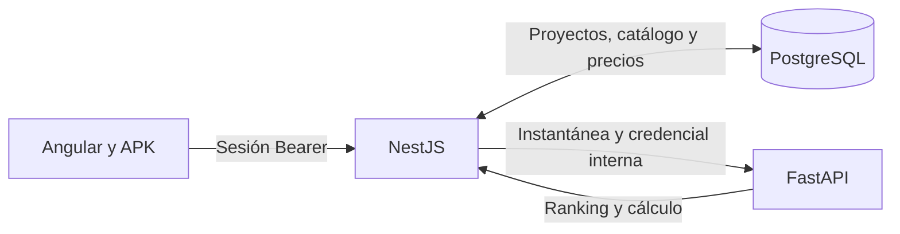

# ADR 0004 — Recomendación de pisos con precios persistidos

## Decisión

Angular presenta hasta tres opciones y solicita confirmación cuando cambia el precio. NestJS autentica al usuario, autoriza cada operación por propietario y prepara una instantánea del proyecto, la habitación y el catálogo. PostgreSQL conserva la selección de piso, las preferencias opcionales por habitación y el ajuste de sugerencias por proyecto. FastAPI aplica las reglas a la instantánea con el cálculo decimal de cajas que ya usa el presupuesto. Las consultas de sugerencias leen datos guardados y las capturas siguen siendo una operación independiente.

La separación permite probar el cálculo sin acceso a tiendas ni a PostgreSQL. Un cambio de preferencias ordena las opciones sin reemplazar el piso guardado. NestJS comprueba que la cotización siga vigente antes de guardar y devuelve la nueva cotización si el cálculo cambió. Los descartes duran la sesión del cliente y afectan únicamente a la habitación consultada.

El contrato de cliente y los casos de prueba están en el [contrato v1](../final/contrato-sugerencias-v1.md). El presupuesto disponible descuenta los costos calculables de los otros recintos, aplica el límite de la habitación cuando existe y avisa si hay costos pendientes. La muestra cubre cerámica para piso y laminado de Sodimac y Easy para La Florida. Un dato de disponibilidad desconocida se muestra como «Disponibilidad sin confirmar». Después de 24 horas se identifica la antigüedad del precio guardado.

## Permisos y datos

| Riesgo o dato | Control y alcance |
| --- | --- |
| Lectura o cambios en un proyecto ajeno | Sesión vigente y autorización por propietario para preferencias, ajustes, consulta y aceptación. |
| Solicitudes repetidas a operaciones costosas | Cuotas por operación y conexión en el proceso NestJS. Detrás de un solo proxy, la cuota protege al backend en conjunto. Una respuesta `429` informa el período de espera. |
| Acceso a procesamiento interno | NestJS y FastAPI comparten una credencial interna. Se configura mediante Secrets del entorno o el `.env` local excluido de Git. Los logs correlacionan solicitudes sin mostrar la credencial. |
| Precio cambiado o confirmación reenviada | Cotización firmada vinculada al propietario y al contexto del cálculo. El precio persistido se revisa antes de guardar. |
| Credenciales de sesión y datos de vivienda | El cliente conserva la sesión en la pestaña y la base conserva el identificador del propietario, su cuenta, las habitaciones, preferencias y selecciones. Eliminar un proyecto borra sus habitaciones. Los datos del catálogo tienen un ciclo independiente. |
| Historial y copias de respaldo | El catálogo mantiene observaciones para comparar cambios de precio. El entorno local conserva el historial y los respaldos hasta que el operador aplica su política de retención. Restaurar una copia en una base separada permite comprobar su integridad. |

## Verificación y feedback de EP1

- **Justificar arquitectura.** Este ADR y la [vista de arquitectura](../architecture/overview.md) documentan los límites NestJS, FastAPI y PostgreSQL.
- **Separar CI y CD.** [CI](../../.github/workflows/ci.yml) prueba contratos, migraciones y contenedores. [CD](../../.github/workflows/deploy-local.yml) exige CI aprobada para el commit final antes de ejecutar en el runner Windows. El [manual operativo](../final/operacion-windows.md) indica cómo verificar la SHA y guardar evidencia.
- **Profundizar Python.** FastAPI reutiliza la normalización y el cálculo de pisos y agrega ranking por presupuesto y preferencia. El smoke de CI prueba el recorrido desde la API pública hasta FastAPI con importaciones de prueba, incluida la reconfirmación de precio.
