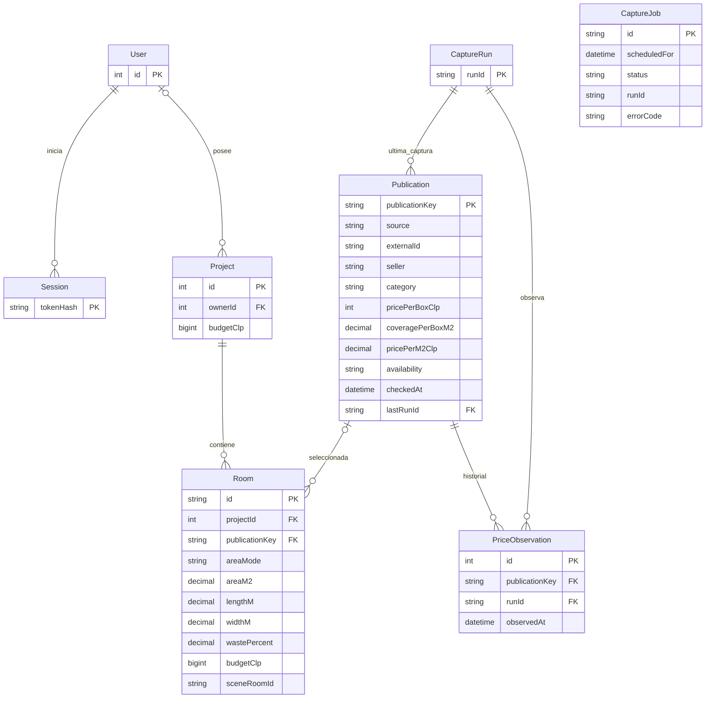

# Modelo de datos de Habita3D

Actualizado para EP2 el 24/10/2026. El esquema ejecutable está en
[Prisma](../../backend/prisma/schema.prisma), con migraciones aditivas en
[`backend/prisma/migrations`](../../backend/prisma/migrations). NestJS administra
PostgreSQL; FastAPI devuelve resultados procesados y no escribe estas tablas.

## Modelo implementado

`CaptureJob.runId` referencia el identificador de resultado cuando existe, sin FK:
un fallo anterior a la importación debe poder registrarse sin una `CaptureRun`.
Los trabajos manuales tienen UUID; los programados tienen ID determinista por franja.

| Entidad | Datos y restricciones |
| --- | --- |
| `User`, `Session` | Email único, contraseña derivada con scrypt y hash del token de sesión; sin almacenar la contraseña ni el token en claro. |
| `Project` | Propietario, nombre y presupuesto entero CLP. Proyectos heredados EP1 con propietario nulo permanecen fuera del CRUD privado EP2. |
| `Room` | UUID, proyecto, área o dimensiones excluyentes, margen inicial 10 %, límite opcional, piso opcional y vínculo al visor. Claves foráneas y CHECK de modalidad/rangos. |
| `Publication` | Identidad estable por fuente, identificador externo, SKU, vendedor, comuna, moneda y precio público; ubicación La Florida, URLs, imagen/marca opcionales, promociones y evidencia. Precio entero, cobertura/precio por m² decimales; stock desconocido explícito. |
| `CaptureRun` | Resultado inmutable identificado por runId, huella del payload, fechas, origen/disparador, grupos, métricas y conteos de importación. |
| `PriceObservation` | Precio/envase/cobertura y fecha de observación inicial o cambio; restricción única publicación+captura. |
| `CaptureJob` | Reserva durable de una ejecución, inicio/fin, franja, correlación y fallo, incluso si FastAPI no respondió. |

## Actualización, precisión y consultas

- Índices por propietario/fecha en proyectos, por proyecto/publicación en habitaciones,
  por categoría/fuente/precio y fecha en publicaciones, por publicación/fecha en historial
  y por inicio/fin en ejecuciones.
- Campos nuevos de fecha con `timestamptz`; las APIs entregan ISO y presentación
  `DD/MM/AAAA HH:MM` en `America/Santiago`.
- Prisma conserva superficies/coberturas y precios por m² como Decimal. JSON los
  serializa como cadenas; presupuestos BigInt acotados a 10^15 se entregan como
  enteros seguros. El precio público por caja admite de 1 a 10^9 CLP.
- La importación usa una transacción y bloqueo PostgreSQL. Una fecha antigua no
  pisa un dato reciente; un mismo runId con payload distinto se rechaza. No se
  borran publicaciones ni selecciones por fallos de una tienda.
- Mismo precio y envase: renueva comprobación, sin duplicar historial. Cambio de
  precio o envase: nueva observación con su contexto para no confundir comparaciones.
- El presupuesto lee habitaciones y publicaciones en una instantánea `RepeatableRead`
  y termina la transacción antes de llamar a FastAPI. La habitación guarda la
  selección, no una copia congelada del precio. No se crean versiones de presupuesto.
- Eliminar un proyecto elimina sus habitaciones, sin eliminar catálogo/historial.
  Las publicaciones elegidas no se eliminan por cascada desde una captura.

El [manual del bloque 2](../ep2/bloque-2-backend.md) documenta entradas, respuestas,
idempotencia y errores. El motor adaptativo completo y las pantallas de selección
pertenecen a las etapas indicadas en el [plan](../ep2/plan-de-trabajo.md).
