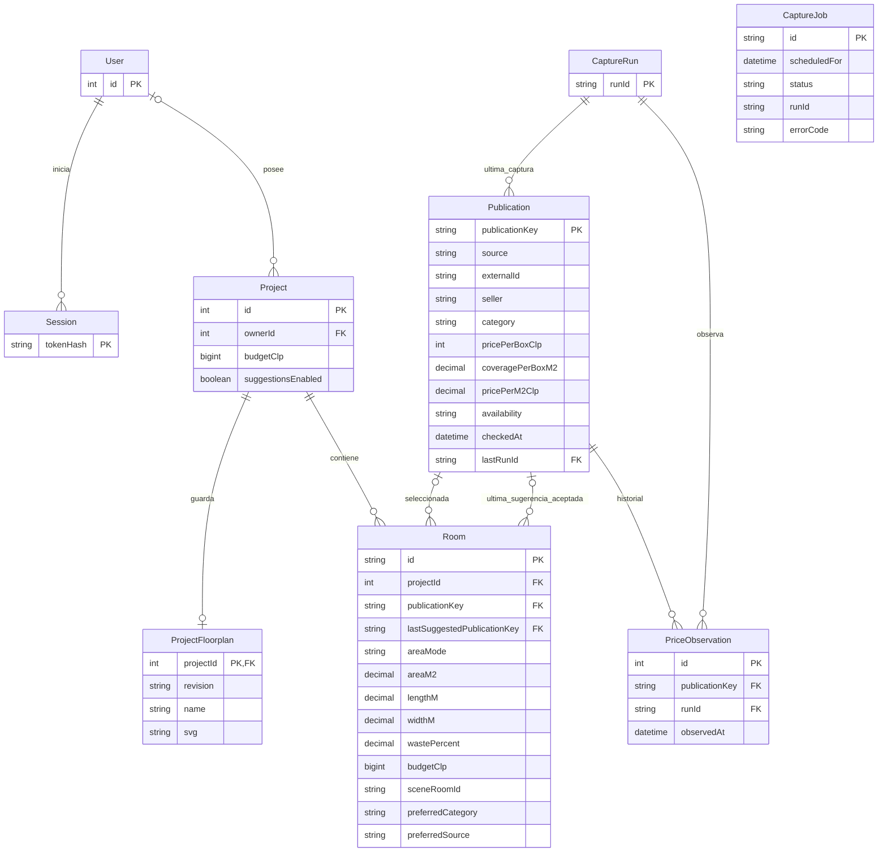

# Modelo de datos de Habita3D

El modelo de la entrega final integra proyectos privados, planos SVG,
selecciones y preferencias por habitación con el catálogo persistido. NestJS
administra PostgreSQL. FastAPI recibe una instantánea de los datos que necesita
calcular y devuelve el resultado a NestJS.
[Esquema Prisma](../../backend/prisma/schema.prisma) ·
[Migraciones](../../backend/prisma/migrations)

## Modelo implementado

`CaptureJob.runId` guarda el identificador de resultado cuando existe. El campo
carece de clave foránea para poder registrar un fallo anterior a la importación.
Los trabajos manuales tienen UUID y los programados tienen ID determinista por franja.

| Entidad | Datos y restricciones |
| --- | --- |
| `User`, `Session` | Email único, hash de contraseña derivado con scrypt, hash del token de sesión y fecha de vencimiento. |
| `Project` | Propietario, nombre, presupuesto entero CLP y ajuste `suggestionsEnabled`, activado por defecto. Los proyectos demostrativos heredados de EP1 tienen propietario nulo y quedan fuera de los proyectos privados. |
| `ProjectFloorplan` | Un plano CubiCasa opcional por proyecto, con nombre, contenido SVG y revisión UUID. El identificador del proyecto es la clave primaria y foránea. |
| `Room` | UUID, proyecto, área o dimensiones excluyentes, margen inicial del 10 %, límite de presupuesto y enlace opcional al recinto (`sceneRoomId`). Guarda el piso vigente (`publicationKey`), la última sugerencia aceptada (`lastSuggestedPublicationKey`) y las preferencias opcionales de categoría y tienda. Los CHECK validan modalidad, rangos y valores de preferencias. |
| `Publication` | Clave estable de publicación, fuente, identificador externo, SKU, vendedor, categoría, moneda y precio público para La Florida. Incluye URLs, imagen y marca opcionales, promociones y evidencia. El precio por caja es entero y la cobertura y el precio por m² son decimales. La disponibilidad desconocida queda explícita. |
| `CaptureRun` | Resultado inmutable identificado por runId, huella del payload, fechas, origen/disparador, grupos, métricas y conteos de importación. |
| `PriceObservation` | Precio/envase/cobertura y fecha de observación inicial o cambio; restricción única publicación+captura. |
| `CaptureJob` | Reserva durable de una ejecución, inicio/fin, franja, correlación y fallo, incluso si FastAPI no respondió. |

## Actualización, precisión y consultas

- Índices por propietario/fecha en proyectos, por proyecto/publicación en habitaciones,
  por última sugerencia aceptada, por categoría/fuente/precio y fecha en
  publicaciones, por publicación/fecha en historial y por inicio/fin en ejecuciones.
- Las fechas de habitaciones, publicaciones, capturas y observaciones usan
  `timestamptz`. La API expone la fecha de comprobación en ISO y la interfaz
  muestra `DD/MM/AAAA HH:MM` en `America/Santiago`.
- Prisma conserva superficies/coberturas y precios por m² como Decimal. JSON los
  serializa como cadenas. Los presupuestos BigInt acotados a 10^15 se entregan
  como enteros seguros. El precio público por caja admite de 1 a 10^9 CLP.
- La importación usa una transacción y un bloqueo de PostgreSQL. Conserva el dato
  más reciente, rechaza un `runId` repetido con un contenido distinto y retiene
  publicaciones y selecciones cuando falla una tienda.
- Una comprobación exitosa renueva la fecha. El historial agrega una observación
  al importar una publicación por primera vez o al cambiar el precio, la unidad
  de venta o la cobertura.
- Cambiar el SVG genera una revisión nueva y limpia los vínculos anteriores con
  los recintos. Las habitaciones, pisos y preferencias se conservan. Las
  operaciones que vinculan recintos o aplican un piso a todo el plano validan
  la revisión vigente.
- Eliminar un proyecto borra sus habitaciones y su plano en cascada. El catálogo
  y su historial son independientes. Una publicación seleccionada tiene borrado
  restringido. Si se elimina una publicación que solo figura como última
  sugerencia aceptada, la referencia queda en `NULL`.

## Presupuesto, preferencias y aceptación

El presupuesto y las sugerencias leen habitaciones y publicaciones en una
instantánea `RepeatableRead`. Cierran la transacción antes de llamar a FastAPI.
El presupuesto se recalcula con los últimos precios persistidos. La habitación
guarda la clave del piso vigente y usa el presupuesto del proyecto y su límite
opcional para calcular las alternativas.

Las preferencias aceptan `ceramic` o `laminate` para categoría y `sodimac` o
`easy` para tienda. Pueden dejarse en `NULL`. Los descartes se guardan en la
sesión de la interfaz por proyecto y habitación. El motor usa las preferencias
declaradas y el contexto del cálculo.

Una aceptación válida guarda la clave de publicación como piso vigente y
última sugerencia aceptada en la misma operación. Elegir o quitar un piso
manualmente conserva la referencia a esa última sugerencia, que se puede volver
a previsualizar desde una habitación vinculada al plano. La API devuelve
`lastSuggestedPublicationKey: null` si todavía no existe una aceptación. La
cotización firmada identifica los datos usados para verificar el costo. Cuando
cambian, NestJS devuelve una cotización actualizada para confirmación.

[Contrato v1 de sugerencias](../final/contrato-sugerencias-v1.md) ·
[Persistencia y programación de EP2](../ep2/bloque-2-backend.md)
