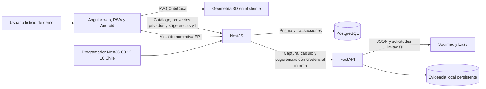
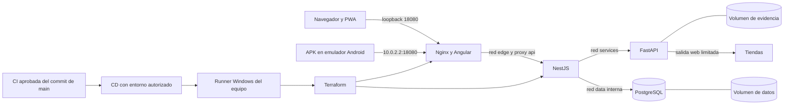

# Arquitectura de Habita3D

Habita3D integra un visor web y móvil, proyectos privados con planos SVG,
presupuestos por habitación y sugerencias de pisos sobre un catálogo persistido.
El [contrato v1](../final/contrato-sugerencias-v1.md) define la integración de
Angular con NestJS. El [ADR 0004](../adr/0004-recomendaciones-adaptativas.md)
justifica las reglas de recomendación y el reparto entre servicios.

## Problema y decisiones

Los clientes necesitan visualizar una vivienda y elegir terminaciones acordes con
sus preferencias y presupuesto. Habita3D separa el visor, la coordinación/persistencia
y el procesamiento de datos para reutilizar la interfaz web en móvil y mantener
el cálculo de cajas/costos en un único servicio especializado.

- Ionic y Angular comparten la interfaz web, la PWA y el cliente Android
  empaquetado con Capacitor. Three.js interpreta los planos CubiCasa y genera
  la geometría 3D en el cliente. El recorrido usa teclado y mouse en escritorio
  o controles táctiles en el emulador Android.
- NestJS valida entradas, autoriza por propietario, consulta PostgreSQL y coordina
  FastAPI. Es la única aplicación que administra el esquema relacional.
- FastAPI concentra extracción acotada, normalización, métricas, cálculo decimal
  de cajas y ordenamiento de sugerencias. Conserva la evidencia de captura en un
  volumen local. PostgreSQL sirve el catálogo a la aplicación.
- PostgreSQL aporta transacciones, claves foráneas, historial y exclusión entre
  procesos. Las habitaciones conservan selecciones y los presupuestos leen los
  últimos precios importados.
- Docker Compose ofrece ejecución de desarrollo/pruebas; Terraform define staging
  separado sobre el mismo host Docker, con redes y volúmenes propios.

El monorepositorio permite revisar contratos y ejecutar las pruebas de los cuatro
servicios sobre el mismo commit. Separar FastAPI permite probar el procesamiento
de datos y el cálculo de cajas sin iniciar la interfaz ni PostgreSQL. La llamada
adicional introduce latencia y puede fallar. NestJS limita su duración y tamaño,
valida la respuesta y propaga un identificador de solicitud. Si falla el cálculo,
la interfaz informa el estado y la selección guardada sigue disponible.
[Decisión de persistencia y programación](../adr/0003-persistencia-y-actualizacion-ep2.md)

## Flujo de contenedores y datos

### Captura e importación

1. El programador habilitado o una operación manual protegida reserva un trabajo.
   PostgreSQL evita duplicar franjas y adquirir simultáneamente.
2. NestJS llama a FastAPI con contexto/categorías, token interno y correlación.
   No sostiene una transacción mientras espera las fuentes.
3. Python comprueba restricciones de acceso, limita/espacia solicitudes, valida
   cerámicas y laminados directos en La Florida y devuelve `CaptureResult`.
4. NestJS comprueba el contrato e importa en una transacción distinta: deduplicación,
   fechas monótonas e historial inicial/cambios. Captura fallida conserva precios.
5. Las lecturas del catálogo y del historial usan la información publicada en
   PostgreSQL. Proyecto, presupuesto y sugerencias requieren sesión del propietario.

### Presupuesto por habitaciones

1. La sesión autoriza acceso al proyecto; los IDs ajenos devuelven 404.
2. Leer habitaciones, selección y precios bajo `RepeatableRead`.
3. Terminar la transacción y enviar a `/floors/budget` superficie/dimensiones,
   margen y snapshots comprobados de las publicaciones.
4. Validar respuesta y devolver cajas/costos, límites y fecha chilena. Si faltan
   elecciones o cobertura, mostrar subtotal parcial y no un total ficticio.

El historial permite comparar observaciones y el presupuesto se recalcula con el
último precio público guardado. Las promociones condicionadas se registran por
separado. La interfaz muestra `unknown` como «Disponibilidad sin confirmar».
[Modelo de datos](data-model.md) · [Condiciones de las fuentes](../ep2/fuentes-web.md)

### Proyectos, planos y visor

1. Angular valida e interpreta el SVG 2D de CubiCasa. Usa sus recintos para el
   selector en planta y su geometría para generar la vivienda en el visor.
2. `PUT /api/projects/:id/floorplan` guarda el nombre, contenido SVG y revisión
   del plano, con un límite de 1 MiB. Si el proyecto todavía carece de habitaciones,
   crea las que entrega el cliente con sus superficies. Si ya tiene habitaciones,
   se vinculan a los recintos desde el editor. Al reemplazar el plano se limpian
   los vínculos anteriores y se conservan las habitaciones y sus pisos.
3. El visor del proyecto requiere un plano guardado. Carga sus recintos y aplica
   la textura orientativa del piso seleccionado en cada habitación vinculada.
   Una sugerencia se puede probar en 3D antes de aceptarla. El visor libre ofrece
   un plano de ejemplo y admite cargar un SVG propio para esa sesión.

## Compatibilidad EP1

`POST /api/projects/preview` conserva el flujo de EP1. Llama a
`/recommendations/compare` con cifras demostrativas y guarda un proyecto
heredado sin propietario. Los proyectos privados usan el presupuesto por
habitaciones basado en los precios persistidos. Las rutas de captura, cómputo
y recomendación de FastAPI requieren la credencial interna.

## Sugerencias para la entrega final

1. Angular consulta `GET /api/projects/:id/rooms/:roomId/suggestions` con su sesión
   y las exclusiones de la habitación. El usuario puede desactivar las sugerencias
   por proyecto y declarar preferencias de tipo de piso o tienda por habitación.
2. NestJS lee el proyecto y hasta 40 publicaciones calculables en una instantánea
   `RepeatableRead`. Envía a `POST /recommendations/floors` los precios guardados,
   las preferencias y los pisos de las demás habitaciones. La captura web sigue
   su programación independiente.
3. FastAPI reutiliza el cálculo de cajas. Prioriza las opciones dentro del saldo
   disponible por tipo de piso, tienda y costo. Si todas exceden el saldo,
   las ordena por menor exceso. Devuelve hasta tres opciones con sus razones y
   marca el saldo provisional cuando quedan costos de otras habitaciones pendientes.
   Angular muestra la disponibilidad y avisa si el precio supera las 24 horas.
4. Al aceptar, Angular envía `publicationKey` y `quoteId`. NestJS recalcula y
   verifica los datos vigentes antes de guardar. Si cambian las condiciones,
   devuelve `409` con una nueva cotización y conserva la selección anterior
   hasta que el usuario la confirme. Al aceptar una cotización válida, guarda
   el piso y la referencia a la última sugerencia aceptada.

[API y ejemplos de reconfirmación](../final/contrato-sugerencias-v1.md) ·
[Reglas, datos y permisos](../adr/0004-recomendaciones-adaptativas.md)

## Despliegue local

En staging solo el frontend publica puerto local. PostgreSQL queda en red interna
con NestJS; Python no accede a la base. Contraseña y token entran como variables
sensibles, con estado/backups fuera de Git en una carpeta restringida al operador.
El despliegue verifica el mismo commit aprobado en CI, copia de seguridad previa,
migración, salud y lectura funcional; no importa fixtures sintéticos en la demo.

El staging funciona en el computador Windows de un integrante. El CD requiere
habilitar el entorno, configurar el runner y mantener Docker disponible en ese
equipo. El informe del 22 de noviembre registra un ensayo de Terraform y la
demo de navegador, PWA y emulador Android sobre el commit `57c4232`. El
despliegue evaluable requiere su propia comprobación de versión y salud.
[Operación Windows](../final/operacion-windows.md) ·
[PWA y Android](../final/plataformas-windows.md) ·
[Ensayo y evidencias](../final/evidencias-windows.md)

La PWA guarda los recursos estáticos de la aplicación tras la primera carga y
permite abrir el visor de ejemplo sin conexión. Los proyectos, el catálogo y las
sugerencias requieren el servidor. El APK de depuración usa el alias
`10.0.2.2:18080` para acceder al staging desde el emulador del host.

## Seguridad, observabilidad y límites

Los tokens de sesión se guardan como hashes y las contraseñas se derivan con
scrypt. Cada lectura y escritura de proyectos y habitaciones verifica el
propietario. La credencial de captura y procesamiento se usa en el servidor.
JSON y consultas tienen límites y las operaciones SQL usan parámetros.
Liveness, readiness, estados de captura y logs JSON con ID y duración permiten
diagnosticar el flujo.

CI ejecuta lint, pruebas, compilaciones, auditorías y el plan de Terraform.
También busca secretos, analiza código y escanea imágenes con bloqueo de
hallazgos críticos. CD exige CI aprobada para la SHA vigente de `main` y un
entorno habilitado. GitHub administra la protección de la rama. El staging
expone la demo HTTP únicamente en el loopback del equipo.
