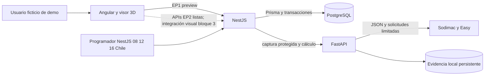
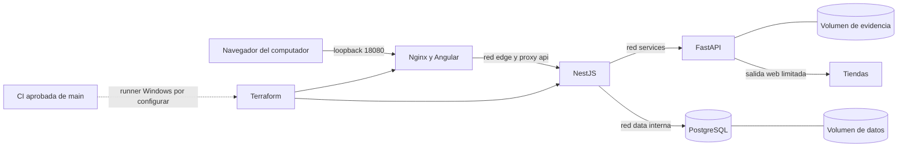

# Arquitectura de Habita3D

Actualizada para EP2, bloques 1 y 2, el 24/10/2026. El recorrido visual actual
conserva la demostración EP1; las pantallas de selección con datos reales
corresponden al bloque 3. El [manual del backend](../ep2/bloque-2-backend.md)
y el [manual de staging](../ep2/bloque-2-staging.md) permiten preparar esa integración.

## Problema y decisiones

Los clientes necesitan visualizar una vivienda y elegir terminaciones acordes con
sus preferencias y presupuesto. Habita3D separa el visor, la coordinación/persistencia
y el procesamiento de datos para reutilizar la interfaz web en móvil y mantener
el cálculo de cajas/costos en un único servicio especializado.

- Ionic/Angular y el visor existente aportan el cliente; Capacitor sigue configurado
  sin plataformas nativas añadidas.
- NestJS valida entradas, autoriza por propietario, consulta PostgreSQL y coordina
  FastAPI. Es la única aplicación que administra el esquema relacional.
- FastAPI concentra extracción acotada, normalización, métricas y cálculo decimal.
  Un caché de evidencia persistente mantiene la muestra; no reemplaza PostgreSQL.
- PostgreSQL aporta transacciones, claves foráneas, historial y exclusión entre
  procesos. Las habitaciones conservan selecciones; los presupuestos leen precios actuales.
- Docker Compose ofrece ejecución de desarrollo/pruebas; Terraform define staging
  separado sobre el mismo host Docker, con redes y volúmenes propios.

Se mantienen cuatro servicios en un repositorio para coordinar contratos y pruebas.
La llamada REST adicional tiene latencia y posibles fallos: se limita tiempo/tamaño,
se valida la respuesta y se propaga un identificador de solicitud. No se reemplazan
errores con precios inventados. Los [ADR](../adr/0003-persistencia-y-actualizacion-ep2.md)
explican persistencia y programación, junto con las decisiones de redes de EP1.

## Flujo de contenedores y datos

### Captura e importación

1. El programador habilitado o una operación manual protegida reserva un trabajo.
   PostgreSQL evita duplicar franjas y adquirir simultáneamente.
2. NestJS llama a FastAPI con contexto/categorías, token interno y correlación.
   No sostiene una transacción mientras espera las fuentes.
3. Python comprueba restricciones de acceso, limita/espacia solicitudes, valida
   cerámicas y laminados directos en La Florida y devuelve `CaptureResult`.
4. NestJS comprueba el contrato e importa en una transacción distinta: deduplicación,
   fechas monótonas e historial inicial/cambios. Captura fallida conserva precios.
5. GET de catálogo, historial, proyecto o presupuesto solo consulta datos propios.

### Presupuesto por habitaciones

1. La sesión autoriza acceso al proyecto; los IDs ajenos devuelven 404.
2. Leer habitaciones, selección y precios bajo `RepeatableRead`.
3. Terminar la transacción y enviar a `/floors/budget` superficie/dimensiones,
   margen y snapshots comprobados de las publicaciones.
4. Validar respuesta y devolver cajas/costos, límites y fecha chilena. Si faltan
   elecciones o cobertura, mostrar subtotal parcial y no un total ficticio.

El historial es informativo y no congela presupuestos. Las promociones condicionadas
no se mezclan con el precio público. `unknown` no significa sin stock. Véanse el
[modelo](data-model.md) y las [condiciones de las fuentes](../ep2/fuentes-web.md).

## Compatibilidad EP1

`POST /api/projects/preview` sigue llamando a `/recommendations/compare` con cifras
demostrativas y persiste un proyecto heredado sin propietario. El visor del navegador
sigue usando su recorrido demostrativo hasta el bloque 3. Los proyectos EP2 privados
usan las nuevas rutas, con presupuesto total y habitaciones; no se atribuyen
automáticamente los proyectos viejos a una cuenta.

## Despliegue local

En staging solo el frontend publica puerto local. PostgreSQL queda en red interna
con NestJS; Python no accede a la base. Contraseña y token entran como variables
sensibles, con estado/backups fuera de Git en una carpeta restringida al operador.
El despliegue verifica el mismo commit aprobado en CI, copia de seguridad previa,
migración, salud y lectura funcional; no importa fixtures sintéticos en la demo.

El equipo eligió el computador Windows de un integrante ($0, sin tarjeta). El
workflow está preparado, pero el compañero registrará el runner posteriormente.
Las pruebas Linux/Docker/macOS y el plan Terraform no certifican el primer despliegue
en ese Windows. El host debe estar encendido y sin suspensión para capturar/desplegar.

## Seguridad, observabilidad y límites

Sesiones con tokens guardados como hashes y contraseñas derivadas con scrypt.
Proyectos/habitaciones aplican propietario en lectura y escritura. Captura/importación
usan otra credencial, del operador; no se incorpora a Angular. JSON y consultas
tienen límites, y las operaciones SQL usan parámetros. Liveness, readiness,
estados de captura y logs JSON con ID/duración permiten diagnosticar el flujo.

CI conserva lint/tests/builds/auditorías/secret scanning y plan Terraform, y agrega
análisis estático y escaneo de imágenes con bloqueo de hallazgos críticos. El
despliegue local se limita a main con CI aprobada y un runner/entorno protegido.
La protección efectiva de main es configuración de GitHub, no una propiedad del YAML.
No se añade TLS ni exposición pública a esta demo local.
